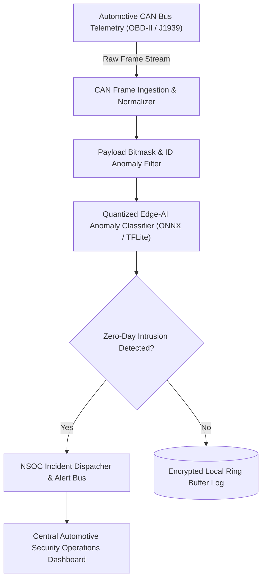

# 🛡️ EdgeGuard — Offline Edge-AI Intrusion Detection System for Automotive CAN Networks
### *Standalone Embedded Machine Learning Pipeline & NSOC Dashboard for Zero-Day Vehicle Cyberattack Detection*

  

  <a href="https://github.com/Tharun4743/EdgeGuard">📦 <b>Official GitHub Repository</b></a>
  

---

## 1. 📌 Problem Statement & Context
Modern connected vehicles, autonomous cars, and electric vehicles communicate internally via the Controller Area Network (CAN) bus. The CAN protocol lacks inherent encryption or sender authentication, leaving vehicles vulnerable to malicious spoofing, DoS injection, and remote braking/steering hijacking attacks.

---

## 2. 🔍 Existing Solutions & Critical Gaps
Cloud-based vehicle security solutions are unviable because automotive cyberattacks happen in milliseconds and vehicles frequently operate in cellular dead zones. Standard rule-based firewalls cannot detect novel zero-day payload anomalies.

---

## 3. 💡 Proposed Solution & Architectural Innovation
EdgeGuard is an edge-native automotive intrusion detection system (IDS) that monitors CAN bus message intervals, arbitration IDs, and payload bytes directly on vehicle microcontrollers. It uses an offline machine learning anomaly detection pipeline to identify DoS attacks, fuzzing attacks, and spoofing injections in sub-millisecond real time.

---

## 4. ⚙️ Technical Approach & System Architecture

### 📐 High-Level Architectural Flowchart:

| Automotive Subsystem | Technology | Security Function |
| :--- | :--- | :--- |
| **Bus Sniffer** | Python `can` library, SocketCAN | Intercepts CAN 2.0B arbitration IDs and 8-byte message payloads |
| **Inference Engine** | LightGBM / Quantized ML Model | Evaluates inter-arrival timing and bitwise entropy in sub-5ms cycles |
| **NSOC Visualizer** | React / WebSockets Dashboard | Displays live vehicle bus utilization, alert logs, and flagged ECUs |

---

## 5. 📈 Quantifiable Impact & Measurable Benefits
* ⏱️ **Sub-Millisecond Threat Detection:** Detects bus flood attacks before physical vehicle actuators can be compromised.
* 🔒 **100% Offline Edge Operation:** Protects vehicles completely without requiring internet or cloud connectivity.
* 🛡️ **Critical Automotive Defense:** Protects driver and passenger lives from remote vehicle takeover attacks.

---

## 6. 🚀 Feasibility, Operational Viability & Scalability
* 🔬 **Technical Feasibility:** Designed to interface directly with standard OBD-II ports and automotive CAN transceivers (MCP2515).
* 💼 **Commercial Viability:** High value for EV manufacturers, autonomous fleet operators, and Tier-1 automotive suppliers.

---

## 7. 👨‍💻 Engineering Author

<table border="0" itemscope itemtype="https://schema.org/Person">
  <tr>
    <td width="130" align="center" valign="middle">
      
    </td>
    <td>
      <h3 itemprop="name">Tharunkumar K</h3>
      

        <b itemprop="jobTitle">Full Stack Developer & AI Systems Engineer</b> | <b>V.S.B. Engineering College (VSBEC)</b> 
        🎓 <b>B.Tech in Information Technology</b> — <b>V.S.B. Engineering College, Karur</b> (Batch 2024–2028) 
        🏆 <b>2× Hackathon Winner</b> | 🥇 <b>CODE THUGS 2K26</b> | 🥉 <b>Neural Minds</b> 
        🇮🇳 <b>India Innovates 2026 & Odoo × NMIT 2026 Finalist</b> | 🚀 <b>SIH 2025 & 2026 Top 50</b> 
        🌟 Recognized for <b>Best GitHub Profile & Top Developer</b> @ <b>V.S.B. ENGINEERING COLLEGE</b>
      

      

        🚀 <b>Top Flagship Engineering Projects:</b> 
        • 🏛️ <b>TaskManager (VSBEC IT Vault)</b> — Institutional Task Governance & LeetCode/GitHub Sync &nbsp;&nbsp; 
        • 🧠 <b>AURA</b> — Air-Gapped Local Multimodal RAG Engine & Offline AI Assistant &nbsp; 
        • 🪖 <b>Smart Helmet IoT</b> — SIH Top 50 Dual-Unit Motorcycle Accident Prevention System &nbsp;
      

      

        &nbsp;
        &nbsp;
        &nbsp;
        &nbsp;
        
      

    </td>
  </tr>
</table>

<!-- =========================================================================
   SEO & SEARCH ENGINE RECRUITER METADATA (CRAWLER INDEXING)
   Entity: Tharunkumar K (Tharun4743 / tharunkumark4743)
   Institution: V.S.B. Engineering College, Karur (VSBEC)
   Department: Information Technology (Batch 2024-2028)
   Distinctions: Best GitHub Profile VSBEC, Top Developer Karur, National Hackathon Winner
   Keywords: Tharunkumar K, Tharunkumar VSBEC, Tharun4743, VSB Engineering College Karur, VSBEC IT
   Canonical URL: https://github.com/Tharun4743/EdgeGuard
========================================================================= -->
